# pyChartist

[](LICENSE)


**One Python API for 82 chart types.** Render them as static images (matplotlib or seaborn) or as
interactive figures (Plotly), in notebooks, scripts or Dash dashboards. Charts take their look from
the page or notebook that shows them.

```python
import pychartist as pc

pen = pc.datasets.load("penguins")

pc.bar(pen, "species", "body_mass_g", agg="mean")                        # matplotlib (static)
pc.bar(pen, "species", "body_mass_g", agg="mean", backend="seaborn")     # + 95% CI error bars
pc.bar(pen, "species", "body_mass_g", agg="mean", backend="plotly")      # interactive

pc.eda.analyze(pen, "species", "body_mass_g")      # suitable charts + statistical tests
pc.catalog()                                       # every chart, with "use when / avoid when"
```

## Features

* **82 charts in six families:** comparison, correlation, part-to-whole, time, distribution, and
  geo/flows. There are also five extras for exploratory analysis: mosaic, Q-Q, pair, joint and
  cluster map. See the [catalogue](docs/CATALOG.md).
* **Three backends, one call signature.** matplotlib gives publication-quality static output.
  seaborn adds statistical estimates such as confidence intervals, KDEs and regression fits.
  Plotly adds hover, zoom and Dash integration.
* **Matches its host.** Built-in light and dark themes. `theme="inherit"` uses the active
  matplotlib/seaborn style or Plotly template. Presets cover Jupyter, VS Code, Colab, GitHub
  and all 26 Bootstrap (Dash) themes. Every theme has a `-transparent` variant. See
  [Themes](docs/THEMES.md).
* **Exploratory analysis.** `pc.eda` chooses charts and the matching tests (Shapiro-Wilk,
  Kolmogorov-Smirnov, χ², Pearson, Spearman, t-test, Mann-Whitney, ANOVA, Kruskal-Wallis,
  Fisher) from the variable types.
* **Ready for Dash.** Every chart has `chart.to_dash()`. `pychartist.dashboard.make_app()` builds
  an app with a light/dark switch that re-renders its charts.
* **No SVG assets and no geopandas.** pyChartist computes the shapes for icons, treemaps, circle
  packing, beeswarms, word clouds, Venn/Euler diagrams, Sankey, chord, arc and flowcharts
  itself, so matplotlib and Plotly draw identical geometry.

## Gallery

Click any thumbnail to open it full size. These are the static renders of
`pc.examples.demo(name)`. The interactive Plotly version of each chart is next to its PNG as
`gallery/<family>/<chart>.html` (download it and open it in a browser). Captions and data sources
are in [docs/GALLERY.md](docs/GALLERY.md).

<!-- gallery:start -->

<details open>
<summary><b>1. Comparison</b> (22 charts)</summary>

<table>
<tr>
<td align="center" valign="top" width="25%"><a href="gallery/comparison/bar.png" title="Mean body mass by penguin species">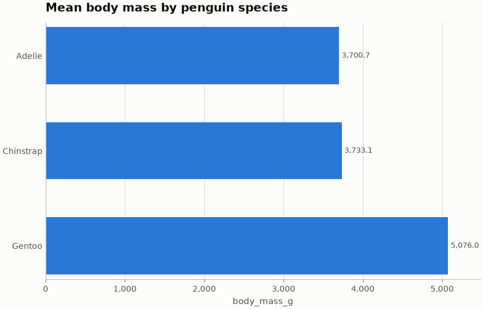</a><br><sub><b>bar</b></sub></td>
<td align="center" valign="top" width="25%"><a href="gallery/comparison/column.png" title="Total restaurant bills by day">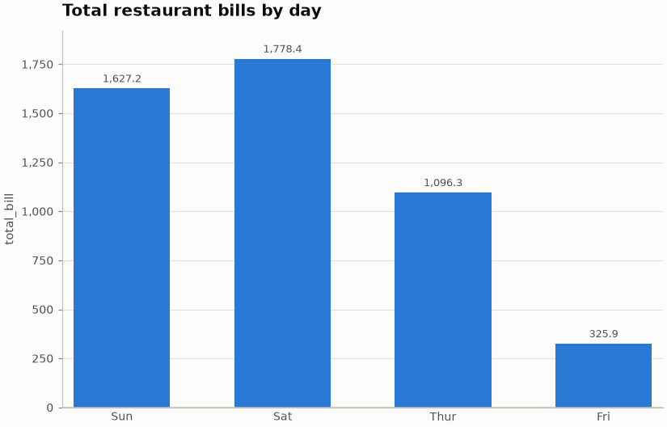</a><br><sub><b>column</b></sub></td>
<td align="center" valign="top" width="25%"><a href="gallery/comparison/grouped_bar.png" title="Mean tip by day and sex">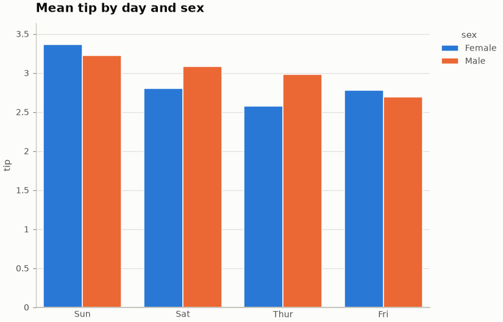</a><br><sub><b>grouped bar</b></sub></td>
<td align="center" valign="top" width="25%"><a href="gallery/comparison/lollipop.png" title="Most populous countries, 2007">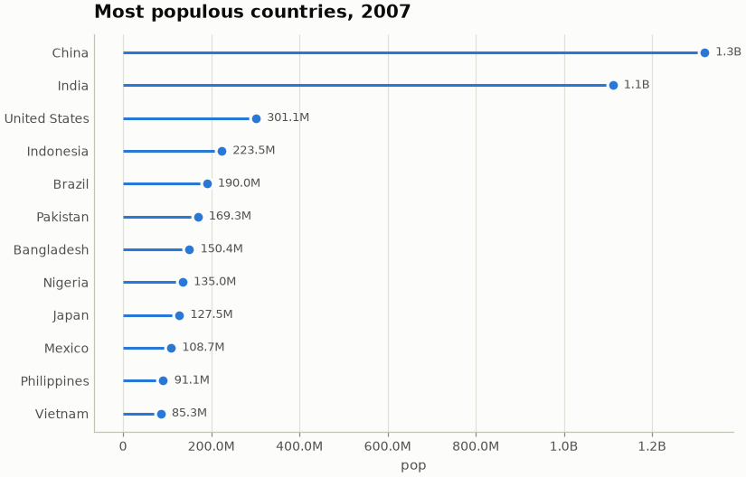</a><br><sub><b>lollipop</b></sub></td>
</tr>
<tr>
<td align="center" valign="top" width="25%"><a href="gallery/comparison/bullet.png" title="KPIs against targets">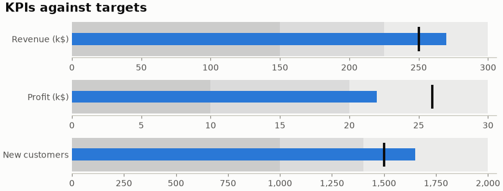</a><br><sub><b>bullet</b></sub></td>
<td align="center" valign="top" width="25%"><a href="gallery/comparison/dot_plot.png" title="Barley yield by site, 1931 vs 1932">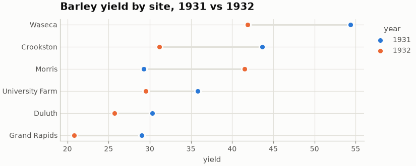</a><br><sub><b>dot plot</b></sub></td>
<td align="center" valign="top" width="25%"><a href="gallery/comparison/dumbbell.png" title="Change in barley yield by site">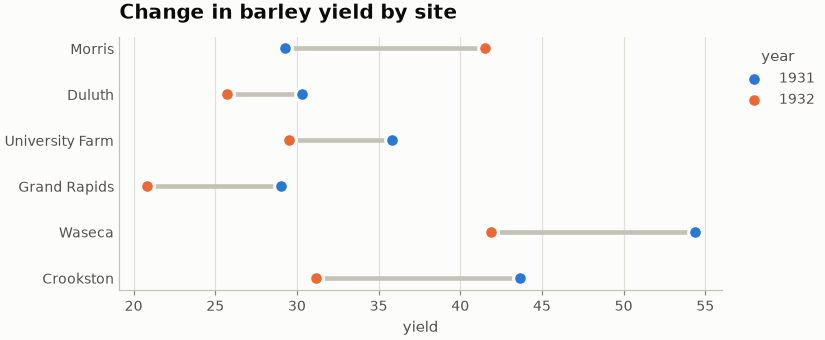</a><br><sub><b>dumbbell</b></sub></td>
<td align="center" valign="top" width="25%"><a href="gallery/comparison/pictogram.png" title="Penguins measured per species (1 icon = 10)">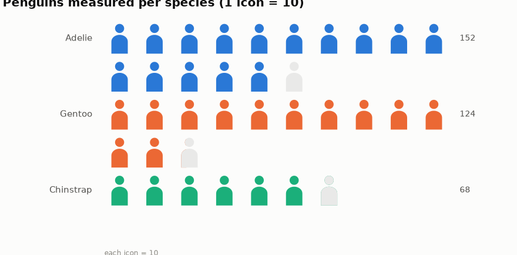</a><br><sub><b>pictogram</b></sub></td>
</tr>
<tr>
<td align="center" valign="top" width="25%"><a href="gallery/comparison/icon_chart.png" title="Population by continent, 2007">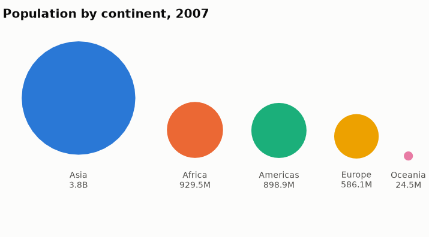</a><br><sub><b>icon chart</b></sub></td>
<td align="center" valign="top" width="25%"><a href="gallery/comparison/range_plot.png" title="Body-mass range per species">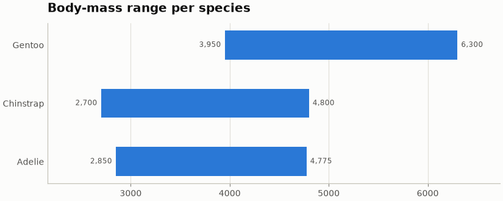</a><br><sub><b>range plot</b></sub></td>
<td align="center" valign="top" width="25%"><a href="gallery/comparison/radial_bar.png" title="Population by continent, 2007">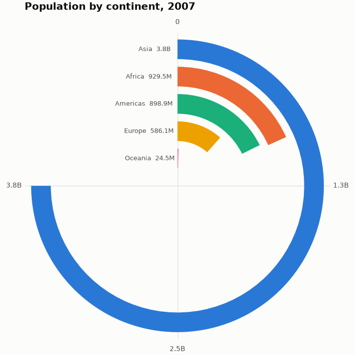</a><br><sub><b>radial bar</b></sub></td>
<td align="center" valign="top" width="25%"><a href="gallery/comparison/parallel_coordinates.png" title="Penguin morphology across four measures">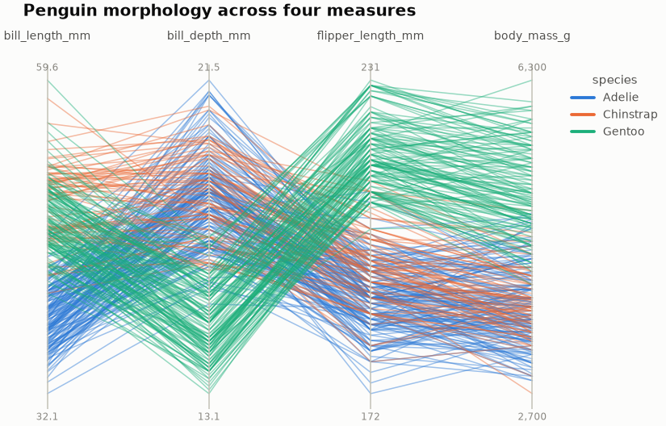</a><br><sub><b>parallel coordinates</b></sub></td>
</tr>
<tr>
<td align="center" valign="top" width="25%"><a href="gallery/comparison/radar.png" title="Species profiles (min-max scaled)">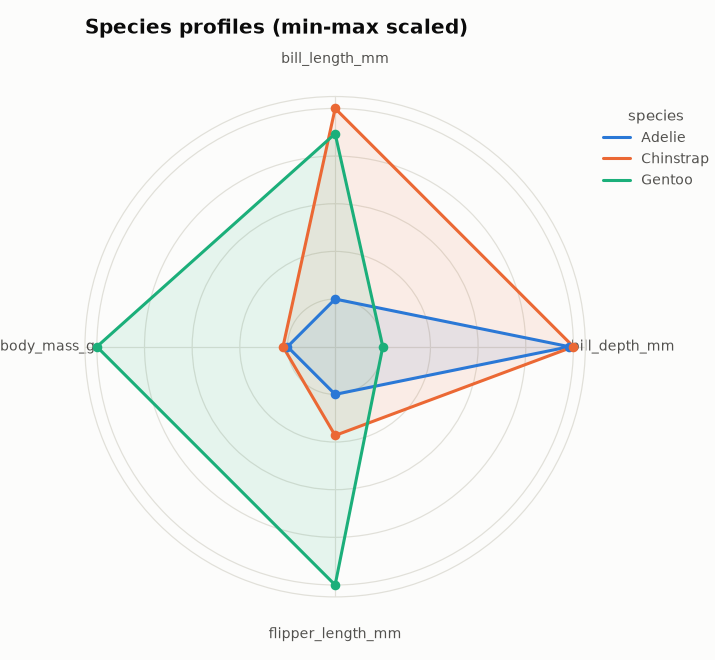</a><br><sub><b>radar</b></sub></td>
<td align="center" valign="top" width="25%"><a href="gallery/comparison/nightingale.png" title="Seattle precipitation by month, 2012-2015">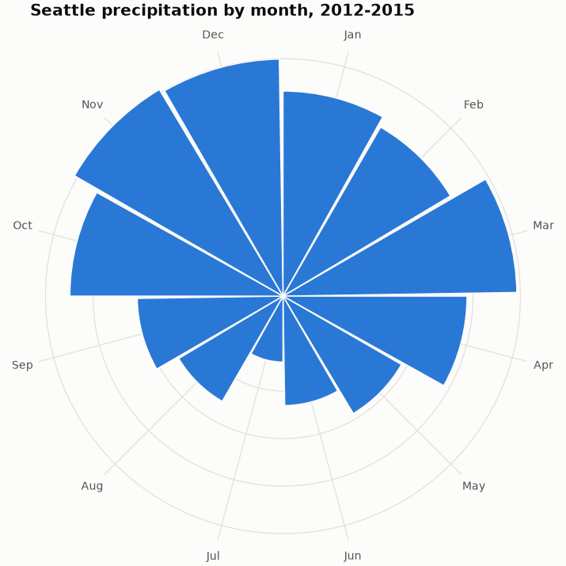</a><br><sub><b>nightingale</b></sub></td>
<td align="center" valign="top" width="25%"><a href="gallery/comparison/waterfall.png" title="Profit bridge">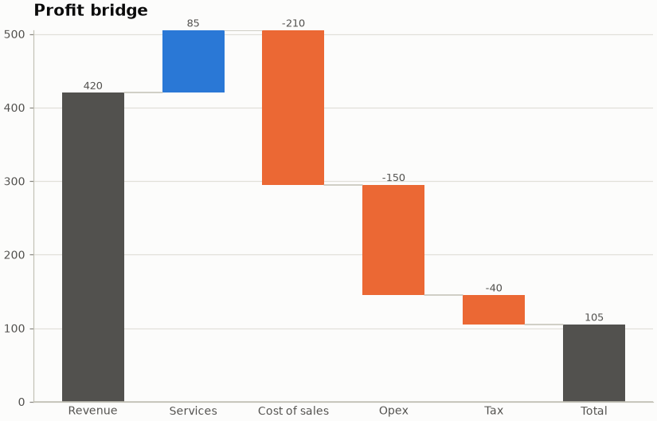</a><br><sub><b>waterfall</b></sub></td>
<td align="center" valign="top" width="25%"><a href="gallery/comparison/matrix_chart.png" title="Number of tables by day and service">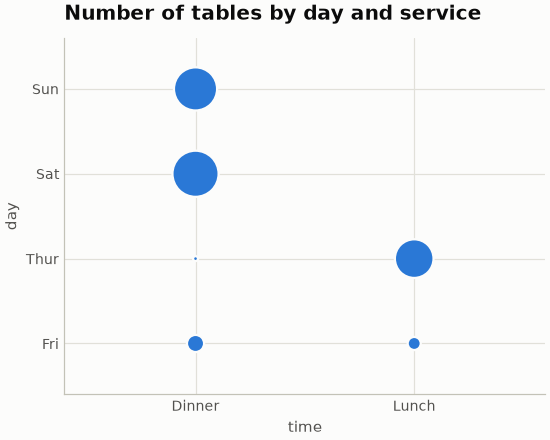</a><br><sub><b>matrix chart</b></sub></td>
</tr>
<tr>
<td align="center" valign="top" width="25%"><a href="gallery/comparison/small_multiples.png" title="Stock prices, one panel per company">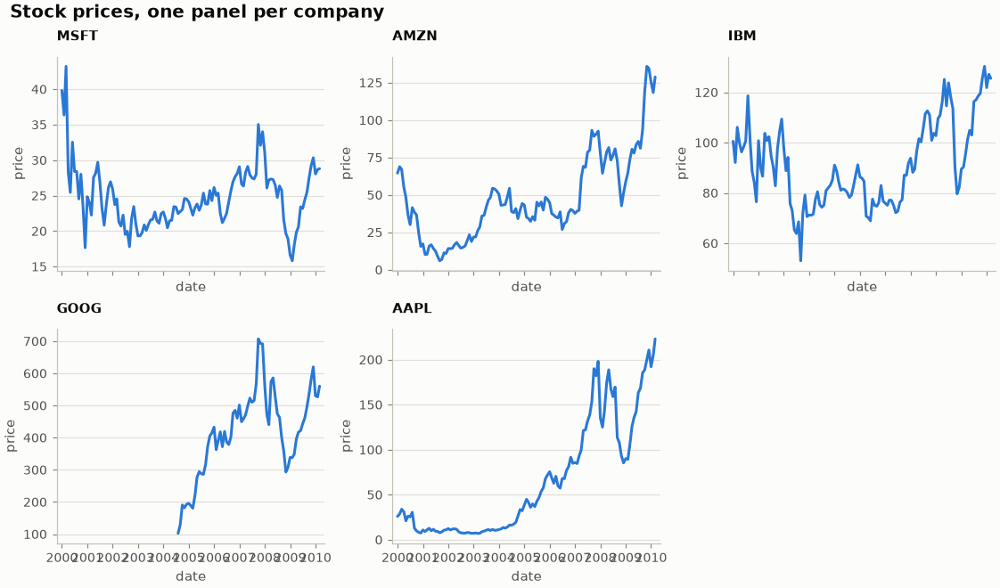</a><br><sub><b>small multiples</b></sub></td>
<td align="center" valign="top" width="25%"><a href="gallery/comparison/word_cloud.png" title="Pride and Prejudice: most frequent words"></a><br><sub><b>word cloud</b></sub></td>
<td align="center" valign="top" width="25%"><a href="gallery/comparison/slope.png" title="Barley yield by site: 1931 → 1932">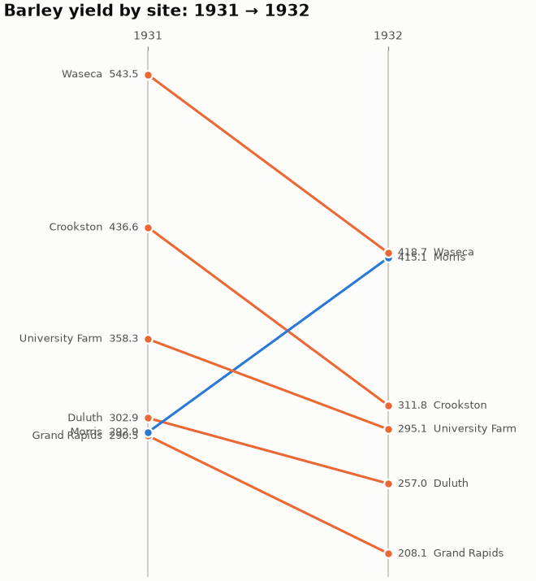</a><br><sub><b>slope</b></sub></td>
<td align="center" valign="top" width="25%"><a href="gallery/comparison/table_chart.png" title="Ten most populous countries, 2007">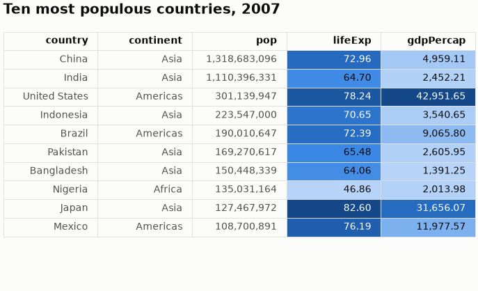</a><br><sub><b>table chart</b></sub></td>
</tr>
<tr>
<td align="center" valign="top" width="25%"><a href="gallery/comparison/categorical_scatter.png" title="Mean tip by day x service">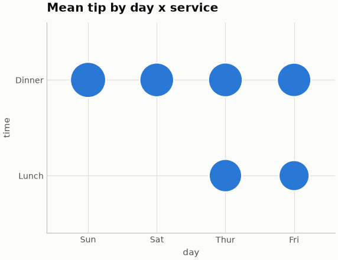</a><br><sub><b>categorical scatter</b></sub></td>
<td align="center" valign="top" width="25%"><a href="gallery/comparison/quadrant.png" title="European countries: wealth vs life expectancy, 2007">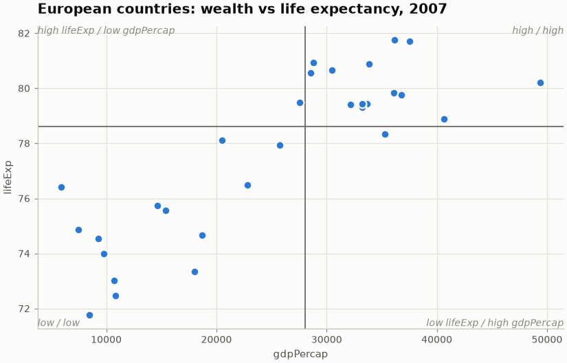</a><br><sub><b>quadrant</b></sub></td>
</tr>
</table>
</details>

<details open>
<summary><b>2. Correlation (relational)</b> (6 charts)</summary>

<table>
<tr>
<td align="center" valign="top" width="25%"><a href="gallery/correlation/heatmap.png" title="Monthly airline passengers 1949-1960">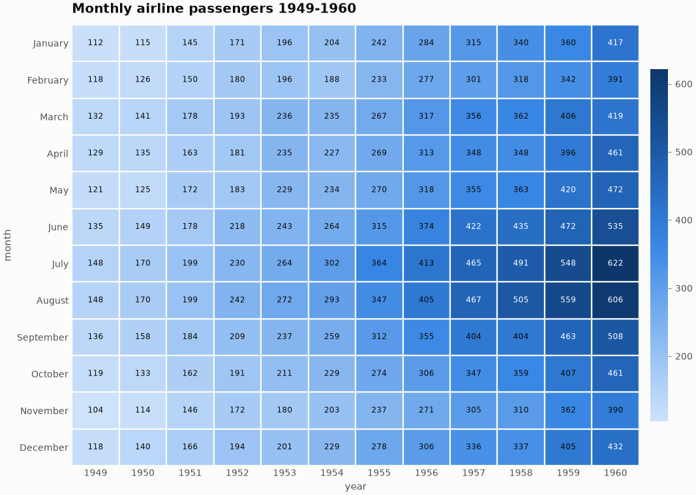</a><br><sub><b>heatmap</b></sub></td>
<td align="center" valign="top" width="25%"><a href="gallery/correlation/scatter.png" title="Flipper length vs body mass">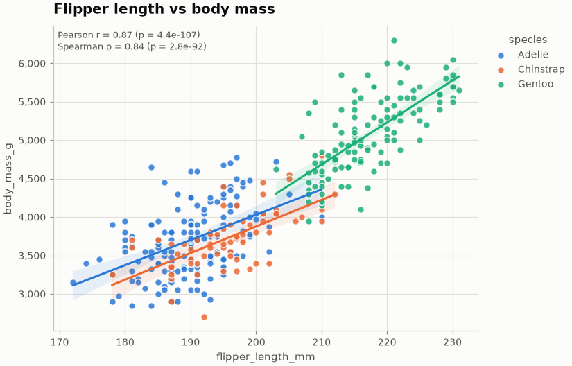</a><br><sub><b>scatter</b></sub></td>
<td align="center" valign="top" width="25%"><a href="gallery/correlation/bubble.png" title="Wealth, health and population, 2007">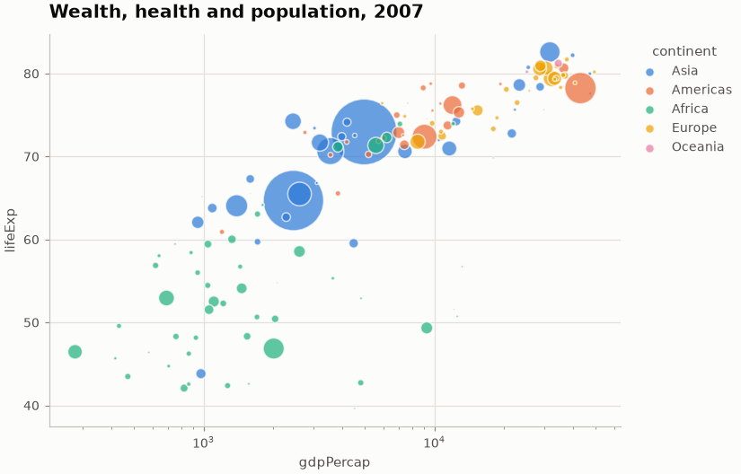</a><br><sub><b>bubble</b></sub></td>
<td align="center" valign="top" width="25%"><a href="gallery/correlation/connected_scatter.png" title="Health spending vs life expectancy, 1970-2020">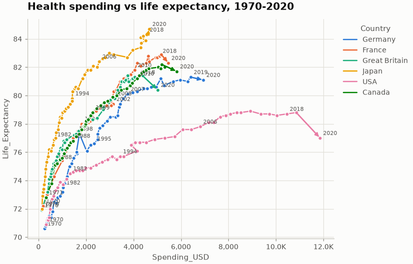</a><br><sub><b>connected scatter</b></sub></td>
</tr>
<tr>
<td align="center" valign="top" width="25%"><a href="gallery/correlation/contour.png" title="Bill length vs depth: point density">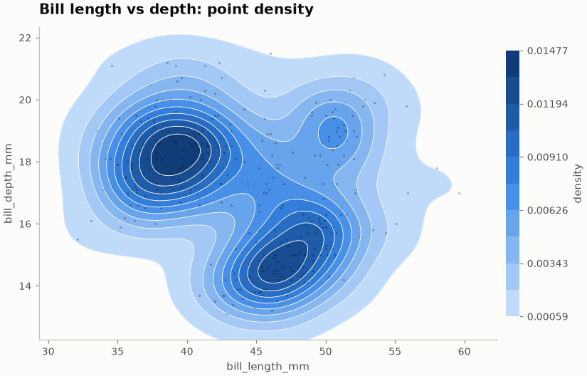</a><br><sub><b>contour</b></sub></td>
<td align="center" valign="top" width="25%"><a href="gallery/correlation/hexbin.png" title="Where 23k significant earthquakes happened">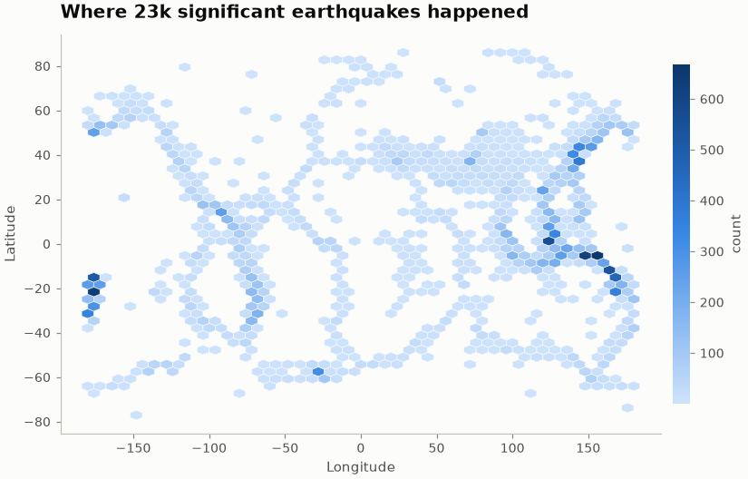</a><br><sub><b>hexbin</b></sub></td>
</tr>
</table>
</details>

<details open>
<summary><b>3. Part-to-whole & hierarchical</b> (19 charts)</summary>

<table>
<tr>
<td align="center" valign="top" width="25%"><a href="gallery/part_to_whole/stacked_bar.png" title="Titanic passengers by class and sex">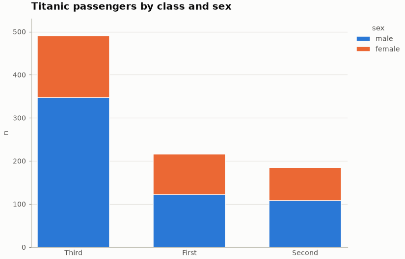</a><br><sub><b>stacked bar</b></sub></td>
<td align="center" valign="top" width="25%"><a href="gallery/part_to_whole/diverging_bar.png" title="Survey: product statements">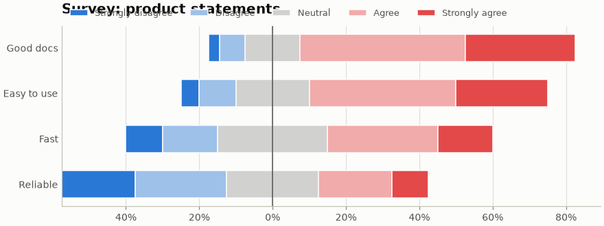</a><br><sub><b>diverging bar</b></sub></td>
<td align="center" valign="top" width="25%"><a href="gallery/part_to_whole/population_pyramid.png" title="US population by age and sex, 2000">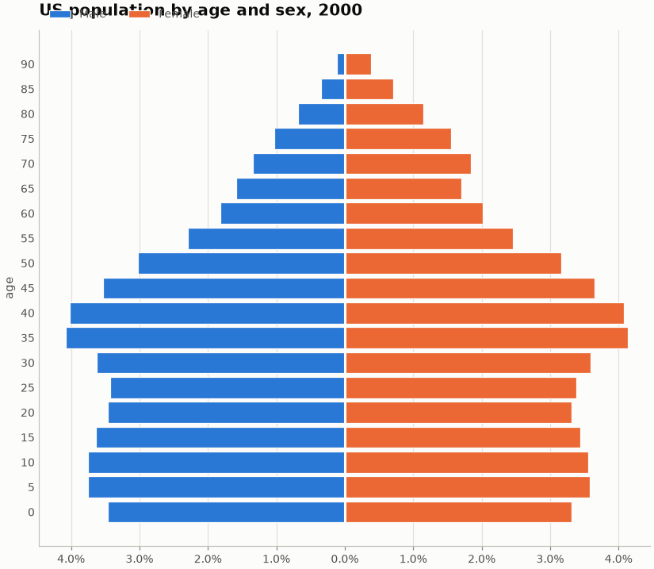</a><br><sub><b>population pyramid</b></sub></td>
<td align="center" valign="top" width="25%"><a href="gallery/part_to_whole/icon_array.png" title="Titanic passengers per 100, by class">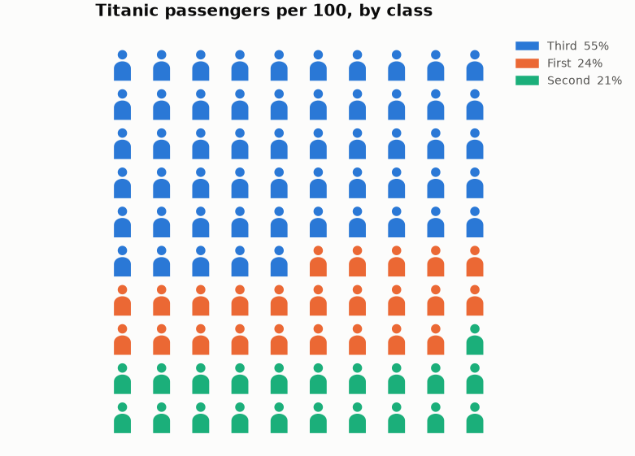</a><br><sub><b>icon array</b></sub></td>
</tr>
<tr>
<td align="center" valign="top" width="25%"><a href="gallery/part_to_whole/waffle.png" title="World population share by continent, 2007">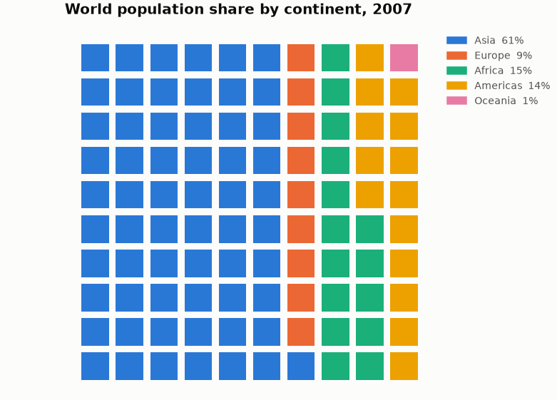</a><br><sub><b>waffle</b></sub></td>
<td align="center" valign="top" width="25%"><a href="gallery/part_to_whole/pie.png" title="Port of embarkation">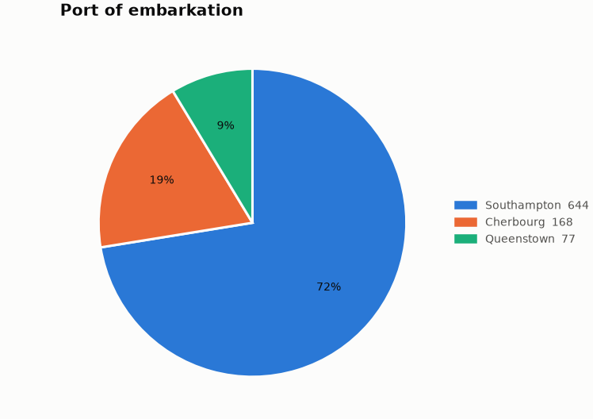</a><br><sub><b>pie</b></sub></td>
<td align="center" valign="top" width="25%"><a href="gallery/part_to_whole/donut.png" title="World population by continent, 2007">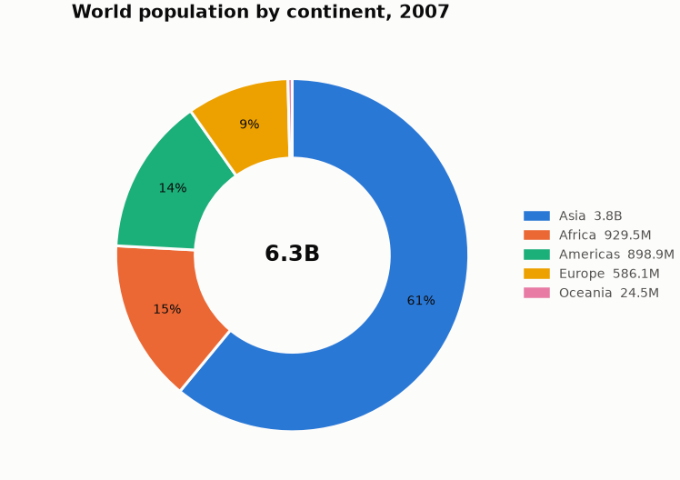</a><br><sub><b>donut</b></sub></td>
<td align="center" valign="top" width="25%"><a href="gallery/part_to_whole/semicircle_donut.png" title="Seats by party">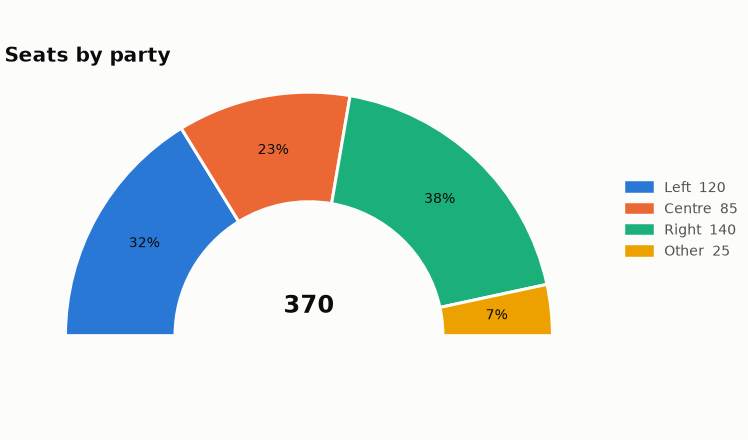</a><br><sub><b>semicircle donut</b></sub></td>
</tr>
<tr>
<td align="center" valign="top" width="25%"><a href="gallery/part_to_whole/marimekko.png" title="Titanic passengers: class x person type">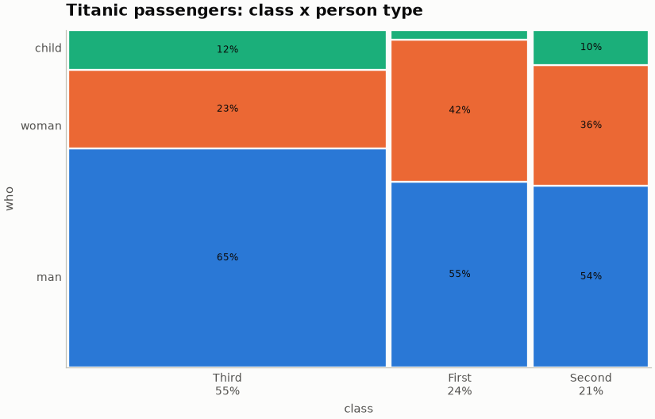</a><br><sub><b>marimekko</b></sub></td>
<td align="center" valign="top" width="25%"><a href="gallery/part_to_whole/mosaic.png" title="Survival by class (residuals from independence)">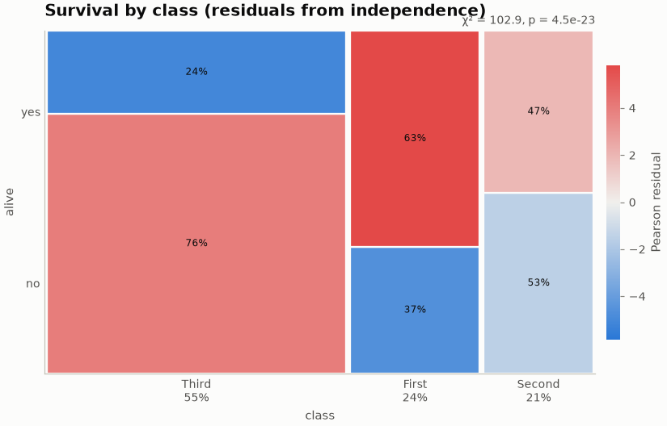</a><br><sub><b>mosaic</b></sub></td>
<td align="center" valign="top" width="25%"><a href="gallery/part_to_whole/treemap.png" title="World population, 2007">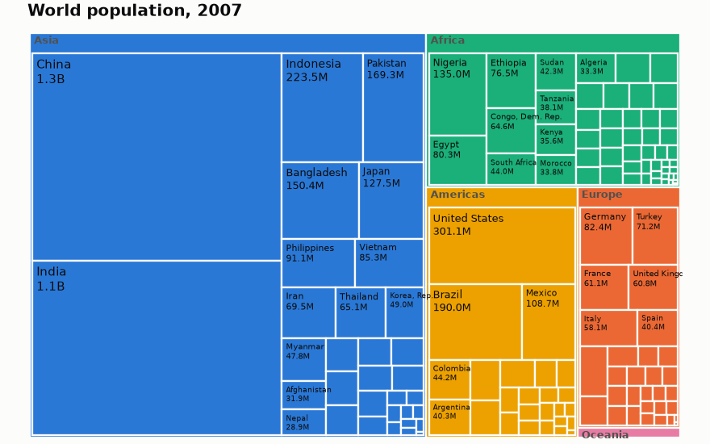</a><br><sub><b>treemap</b></sub></td>
<td align="center" valign="top" width="25%"><a href="gallery/part_to_whole/circular_treemap.png" title="World population, 2007">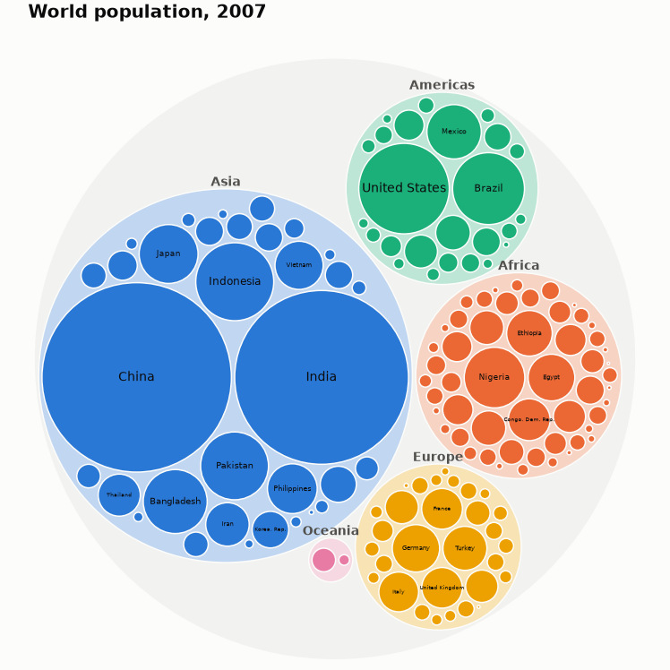</a><br><sub><b>circular treemap</b></sub></td>
</tr>
<tr>
<td align="center" valign="top" width="25%"><a href="gallery/part_to_whole/convex_treemap.png" title="Population of Europe, Africa and the Americas, 2007">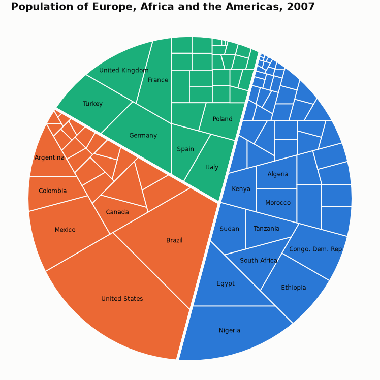</a><br><sub><b>convex treemap</b></sub></td>
<td align="center" valign="top" width="25%"><a href="gallery/part_to_whole/dendrogram.png" title="Clustering 40 cars by specification">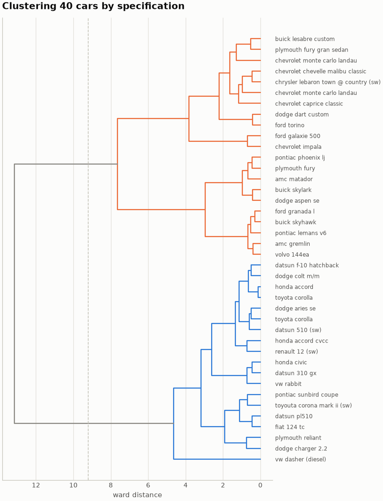</a><br><sub><b>dendrogram</b></sub></td>
<td align="center" valign="top" width="25%"><a href="gallery/part_to_whole/venn.png" title="Titanic: survivors, women and first class">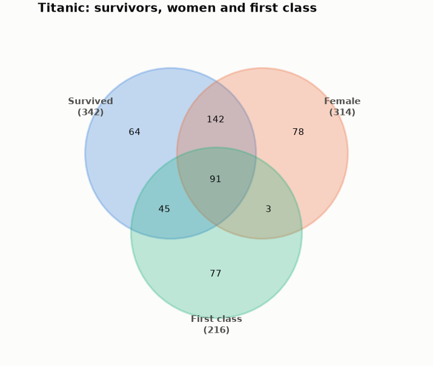</a><br><sub><b>venn</b></sub></td>
<td align="center" valign="top" width="25%"><a href="gallery/part_to_whole/euler.png" title="Titanic: survivors, women and first class (area-proportional)">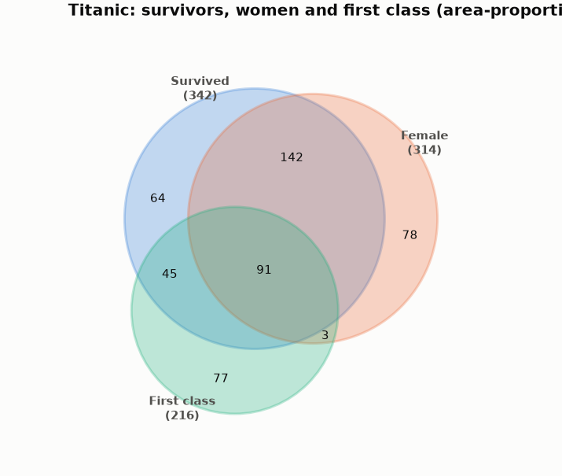</a><br><sub><b>euler</b></sub></td>
</tr>
<tr>
<td align="center" valign="top" width="25%"><a href="gallery/part_to_whole/gauge.png" title="Service uptime score">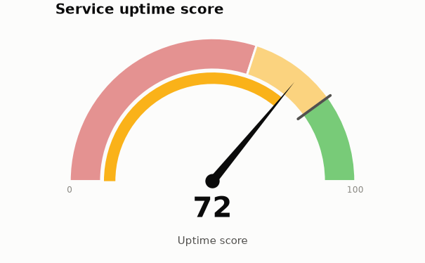</a><br><sub><b>gauge</b></sub></td>
<td align="center" valign="top" width="25%"><a href="gallery/part_to_whole/sunburst.png" title="Titanic: class › sex › survival">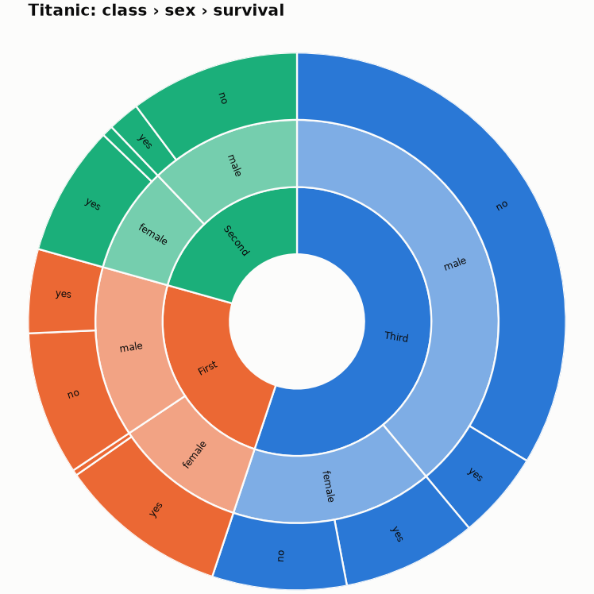</a><br><sub><b>sunburst</b></sub></td>
<td align="center" valign="top" width="25%"><a href="gallery/part_to_whole/funnel.png" title="Conversion funnel">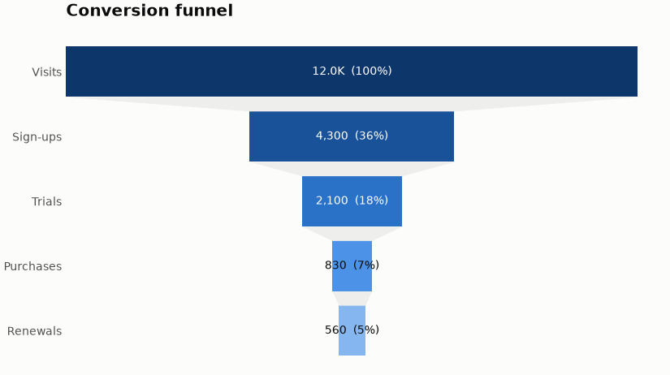</a><br><sub><b>funnel</b></sub></td>
</tr>
</table>
</details>

<details open>
<summary><b>4. Data over time (temporal)</b> (12 charts)</summary>

<table>
<tr>
<td align="center" valign="top" width="25%"><a href="gallery/temporal/line.png" title="Monthly stock prices 2000-2010">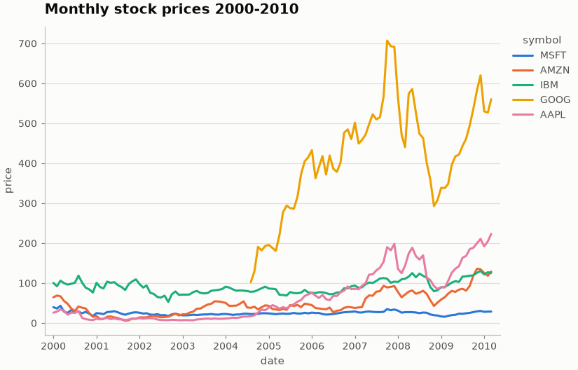</a><br><sub><b>line</b></sub></td>
<td align="center" valign="top" width="25%"><a href="gallery/temporal/spline.png" title="Yearly airline passengers">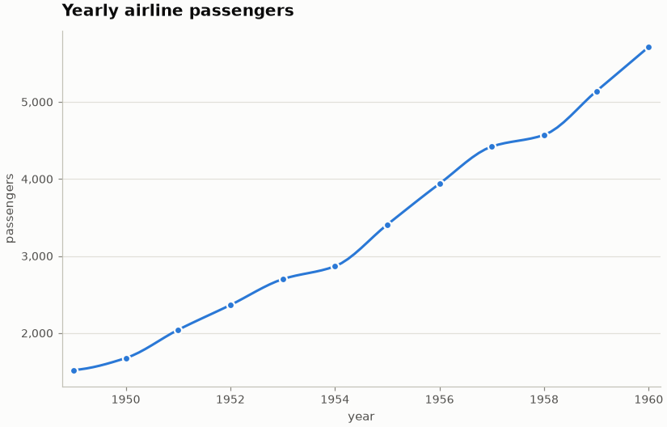</a><br><sub><b>spline</b></sub></td>
<td align="center" valign="top" width="25%"><a href="gallery/temporal/step_line.png" title="Life expectancy, USA vs Japan">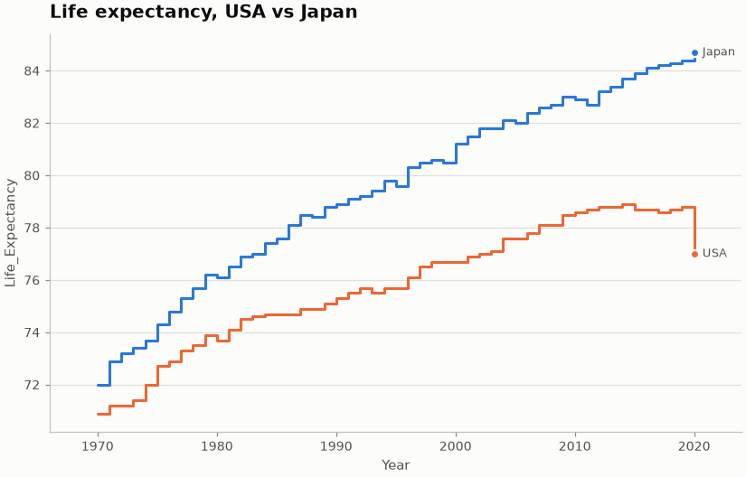</a><br><sub><b>step line</b></sub></td>
<td align="center" valign="top" width="25%"><a href="gallery/temporal/area.png" title="Yearly airline passengers">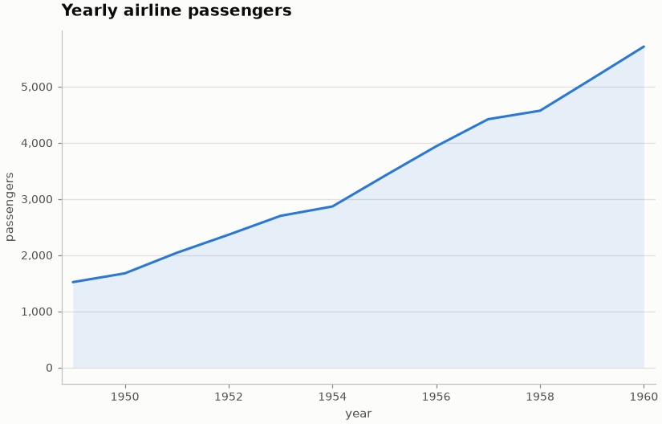</a><br><sub><b>area</b></sub></td>
</tr>
<tr>
<td align="center" valign="top" width="25%"><a href="gallery/temporal/stacked_area.png" title="US unemployment by industry (top 6 + other)"></a><br><sub><b>stacked area</b></sub></td>
<td align="center" valign="top" width="25%"><a href="gallery/temporal/streamgraph.png" title="US unemployment by industry (top 7 + other)"></a><br><sub><b>streamgraph</b></sub></td>
<td align="center" valign="top" width="25%"><a href="gallery/temporal/bump.png" title="GDP per capita rank among seven European countries"></a><br><sub><b>bump</b></sub></td>
<td align="center" valign="top" width="25%"><a href="gallery/temporal/bump_area.png" title="Stock price ranking each January"></a><br><sub><b>bump area</b></sub></td>
</tr>
<tr>
<td align="center" valign="top" width="25%"><a href="gallery/temporal/candlestick.png" title="AAPL, last 60 trading days"></a><br><sub><b>candlestick</b></sub></td>
<td align="center" valign="top" width="25%"><a href="gallery/temporal/ohlc.png" title="AAPL, last 60 trading days"></a><br><sub><b>ohlc</b></sub></td>
<td align="center" valign="top" width="25%"><a href="gallery/temporal/gantt.png" title="Analytics project schedule"></a><br><sub><b>gantt</b></sub></td>
<td align="center" valign="top" width="25%"><a href="gallery/temporal/barcode.png" title="Seattle: snow and fog days, 2012-2015"></a><br><sub><b>barcode</b></sub></td>
</tr>
</table>
</details>

<details open>
<summary><b>5. Distribution</b> (12 charts)</summary>

<table>
<tr>
<td align="center" valign="top" width="25%"><a href="gallery/distribution/histogram.png" title="Flipper length by species"></a><br><sub><b>histogram</b></sub></td>
<td align="center" valign="top" width="25%"><a href="gallery/distribution/density.png" title="Flipper length by species"></a><br><sub><b>density</b></sub></td>
<td align="center" valign="top" width="25%"><a href="gallery/distribution/ridgeline.png" title="Seattle daily maximum temperature by month"></a><br><sub><b>ridgeline</b></sub></td>
<td align="center" valign="top" width="25%"><a href="gallery/distribution/horizon.png" title="Stock prices relative to each company's mean"></a><br><sub><b>horizon</b></sub></td>
</tr>
<tr>
<td align="center" valign="top" width="25%"><a href="gallery/distribution/radial_histogram.png" title="Seattle precipitation by day of year"></a><br><sub><b>radial histogram</b></sub></td>
<td align="center" valign="top" width="25%"><a href="gallery/distribution/strip.png" title="Restaurant bills by day"></a><br><sub><b>strip</b></sub></td>
<td align="center" valign="top" width="25%"><a href="gallery/distribution/jitter.png" title="Restaurant bills by day and sex"></a><br><sub><b>jitter</b></sub></td>
<td align="center" valign="top" width="25%"><a href="gallery/distribution/beeswarm.png" title="Body mass of every penguin"></a><br><sub><b>beeswarm</b></sub></td>
</tr>
<tr>
<td align="center" valign="top" width="25%"><a href="gallery/distribution/heatmap_1d.png" title="Seattle monthly mean maximum temperature (stripes)"></a><br><sub><b>heatmap 1d</b></sub></td>
<td align="center" valign="top" width="25%"><a href="gallery/distribution/box.png" title="Body mass by species (with test)"></a><br><sub><b>box</b></sub></td>
<td align="center" valign="top" width="25%"><a href="gallery/distribution/violin.png" title="Flipper length by species and sex"></a><br><sub><b>violin</b></sub></td>
<td align="center" valign="top" width="25%"><a href="gallery/distribution/qq_plot.png" title="Is penguin body mass normal?"></a><br><sub><b>qq plot</b></sub></td>
</tr>
</table>
</details>

<details open>
<summary><b>6. Geospatial & other</b> (8 charts)</summary>

<table>
<tr>
<td align="center" valign="top" width="25%"><a href="gallery/geo_other/choropleth.png" title="Life expectancy, 2007"></a><br><sub><b>choropleth</b></sub></td>
<td align="center" valign="top" width="25%"><a href="gallery/geo_other/geo_heatmap.png" title="Earthquake density 1965-2016"></a><br><sub><b>geo heatmap</b></sub></td>
<td align="center" valign="top" width="25%"><a href="gallery/geo_other/tile_map.png" title="US agricultural exports by state, 2011 (M$)"></a><br><sub><b>tile map</b></sub></td>
<td align="center" valign="top" width="25%"><a href="gallery/geo_other/sankey.png" title="UK energy flows (2050 projection)"></a><br><sub><b>sankey</b></sub></td>
</tr>
<tr>
<td align="center" valign="top" width="25%"><a href="gallery/geo_other/chord.png" title="Migration between regions"></a><br><sub><b>chord</b></sub></td>
<td align="center" valign="top" width="25%"><a href="gallery/geo_other/arc.png" title="Les Misérables co-occurrence"></a><br><sub><b>arc</b></sub></td>
<td align="center" valign="top" width="25%"><a href="gallery/geo_other/network.png" title="Les Misérables co-occurrence network"></a><br><sub><b>network</b></sub></td>
<td align="center" valign="top" width="25%"><a href="gallery/geo_other/flowchart.png" title="Data publishing workflow"></a><br><sub><b>flowchart</b></sub></td>
</tr>
</table>
</details>

<details open>
<summary><b>EDA (charts + statistical tests)</b> (3 charts)</summary>

<table>
<tr>
<td align="center" valign="top" width="25%"><a href="gallery/eda/pair_plot.png" title="Penguin measurements, pairwise"></a><br><sub><b>pair plot</b></sub></td>
<td align="center" valign="top" width="25%"><a href="gallery/eda/joint_plot.png" title="Bill length vs depth with marginals"></a><br><sub><b>joint plot</b></sub></td>
<td align="center" valign="top" width="25%"><a href="gallery/eda/cluster_map.png" title="30 cars clustered by specification (z-scores)"></a><br><sub><b>cluster map</b></sub></td>
</tr>
</table>
</details>

<!-- gallery:end -->

## Install

```bash
git clone https://github.com/y-v-j/pyChartist.git
cd pyChartist
pip install -e .                      # numpy pandas scipy matplotlib seaborn plotly networkx statsmodels
pip install -e ".[export]"            # optional: PNG/SVG/PDF export of Plotly charts (kaleido)
pip install -e ".[dash]"              # optional: dashboards
pip install -e ".[notebook,dev]"      # optional: run the notebooks and the tests
```

The example datasets are included in `datasets/`. To download them again, run
`python -m pychartist.datasets`.

## The `Chart` object

Every chart function returns a `pychartist.Chart`:

| | |
|---|---|
| `chart` (last line of a cell) | displays inline in Jupyter (PNG for matplotlib/seaborn, interactive for Plotly) |
| `chart.show()` | notebook display, a browser tab (Plotly) or a window (matplotlib) |
| `chart.save("x.png" / ".svg" / ".pdf" / ".html" / ".json")` | export (Plotly images need `kaleido`) |
| `chart.to_dash(id=...)` | `dcc.Graph` (Plotly) or `html.Img` (static) |
| `chart.figure` | the underlying `matplotlib.figure.Figure` or `plotly.graph_objects.Figure` |
| `chart.meta` | extra results: test statistics, cluster labels, residuals, layout data |

Keyword arguments that every chart accepts: `backend`, `theme`, `title`, `ax` (draw into an
existing matplotlib Axes), `figsize`, `width`, `height` and `palette` (a list of colours or a
`{category: colour}` dict). To set defaults, use `pc.set_backend("plotly")`,
`pc.set_theme("dark")` or `with pc.options(...)`.

## Chart families

| Family | Charts |
|---|---|
| Comparison | bar, column, grouped bar, lollipop, bullet, dot plot, dumbbell, pictogram, icon chart, range plot, radial bar, parallel coordinates, radar, Nightingale, waterfall, matrix, small multiples, word cloud, slope, table chart, categorical scatter, quadrant |
| Correlation | heatmap, scatter, bubble, connected scatter, contour, hexbin |
| Part-to-whole | stacked bar, diverging (Likert) bar, population pyramid, icon array, waffle, pie, donut, semicircle donut, Marimekko, mosaic, treemap, circular treemap, convex treemap, dendrogram, Venn, Euler, gauge, sunburst, funnel |
| Time | line, spline, step line, area, stacked area, streamgraph, bump, bump area, candlestick, OHLC, Gantt, barcode |
| Distribution | histogram, density, ridgeline, horizon, radial histogram, strip, jitter, beeswarm, 1-D heatmap, box, violin, Q-Q |
| Geo & other | choropleth, geographic heatmap, tile map, Sankey, chord, arc, network, flowchart |
| EDA (seaborn figure-level) | pair plot, joint plot, cluster map |

Alternative names also work, for example `pc.plot("spider chart", ...)`,
`pc.plot("coxcomb chart", ...)` and `pc.plot("swarm plot", ...)`.

## Themes

```python
pc.set_theme("dark")                                  # or "light", "jupyter-dark", "vscode-dark", "darkly", ...
pc.scatter(df, "x", "y", theme="inherit")             # use the host's matplotlib/seaborn style or Plotly template
pc.violin(df, "g", "v", backend="plotly", theme="dark-transparent")   # blend into a dark page
brand = pc.derive_theme("acme", surface="#0f1b2d", ink="#e8edf5", register=True)
```

The default palette orders eight hues so that adjacent colours stay distinguishable, including
for colour-blind readers. Sequential scales use one hue. Diverging scales use two hues with a
grey midpoint. Charts warn when a chart has more categories than distinguishable colours.
`pc.fold_other` merges the smallest categories into "Other". See [docs/THEMES.md](docs/THEMES.md).

## Dashboards

| App | What it shows | Port |
|---|---|---|
| `dashboards/gallery_app.py` | every chart; switch backend, theme and light/dark | 8054 |
| `dashboards/eda_explorer.py` | pick a dataset and variables; charts and tests are chosen automatically | 8051 |
| `dashboards/world_dashboard.py` | Gapminder cross-filtering: year slider, continent filter, click to select a country | 8052 |
| `dashboards/themed_app.py` | minimal `make_app` example mixing Plotly, seaborn and matplotlib cards | 8053 |

```python
from pychartist.dashboard import make_app

app = make_app("Penguins", {
    "Body mass": lambda theme: pc.violin(pen, "species", "body_mass_g", backend="plotly", theme=theme),
    "Bill size": lambda theme: pc.scatter(pen, "bill_length_mm", "bill_depth_mm", "species", theme=theme),
}, bootstrap="FLATLY", dark_bootstrap="DARKLY")
app.run()
```

## Notebooks

The executed example notebooks are in [`notebooks/`](notebooks):

1. [Quick start](notebooks/01_quickstart.ipynb)
2. [Comparison charts](notebooks/02_comparison_charts.ipynb)
3. [Correlation and distribution](notebooks/03_correlation_and_distribution.ipynb)
4. [Part-to-whole and hierarchy](notebooks/04_part_to_whole_and_hierarchy.ipynb)
5. [Time series](notebooks/05_time_series.ipynb)
6. [Geo, flows and networks](notebooks/06_geo_flows_networks.ipynb)
7. [EDA workflow](notebooks/07_eda_workflow.ipynb)
8. [Themes and host compatibility](notebooks/08_themes_and_host_compatibility.ipynb)

## Datasets

The repository includes 22 freely available datasets: Palmer penguins, tips, Titanic, flights,
MPG, iris, health expenditure, Gapminder, AAPL OHLC, world GDP, US agricultural exports, USGS
earthquakes, UK energy Sankey, the Les Misérables network, US census population, barley,
Seattle weather, stocks, US unemployment by industry, Natural Earth countries, US state
boundaries and *Pride and Prejudice*. Each keeps its own licence. Sources and licences are
listed in [datasets/SOURCES.md](datasets/SOURCES.md).

## Design references

The design borrows from three JavaScript libraries:

* **d3:** charts are functions of tidy data. The layout algorithms are ports of d3's: `d3.pack`
  front-chain circle packing, `d3.partition`, `d3-sankey`, `d3.chord`, d3-cloud's spiral word
  placement, and `curveMonotoneX` (via PCHIP).
* **nvd3:** reusable chart objects with sensible defaults and built-in tooltips.
* **Chartist:** small, responsive charts styled by the surrounding page. This is the idea
  behind the `inherit` theme and the `-transparent` variants.

The `d3`, `nvd3` and `chartist` themes reproduce the series colours of those libraries.

## Development

```bash
python -m pytest                          # 297 tests
python scripts/build_gallery.py --html    # gallery images, docs and this README's gallery grid
scripts/run_notebooks.sh                  # regenerate and execute the notebooks (PY=..., KERNEL=... to override)
```

Every number the library produces is tested against an independent reference. Statistics are
compared with statsmodels or closed-form formulas. Drawn values (bar heights, histogram counts,
correlation matrices, waffle units, Sankey and treemap values) are compared with pandas or
numpy. Layouts are checked for exact areas and zero overlaps. To add a new chart, see
[docs/ARCHITECTURE.md](docs/ARCHITECTURE.md).

Plotly image export uses kaleido's Chromium, which hangs under `ulimit -v`. To cap memory, use
a cgroup instead, for example `systemd-run --user --scope -p MemoryMax=5G ...`.

## License

pyChartist is released under the [MIT License](LICENSE). The bundled datasets keep their original
licences (see [datasets/SOURCES.md](datasets/SOURCES.md)).
